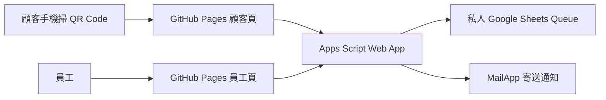
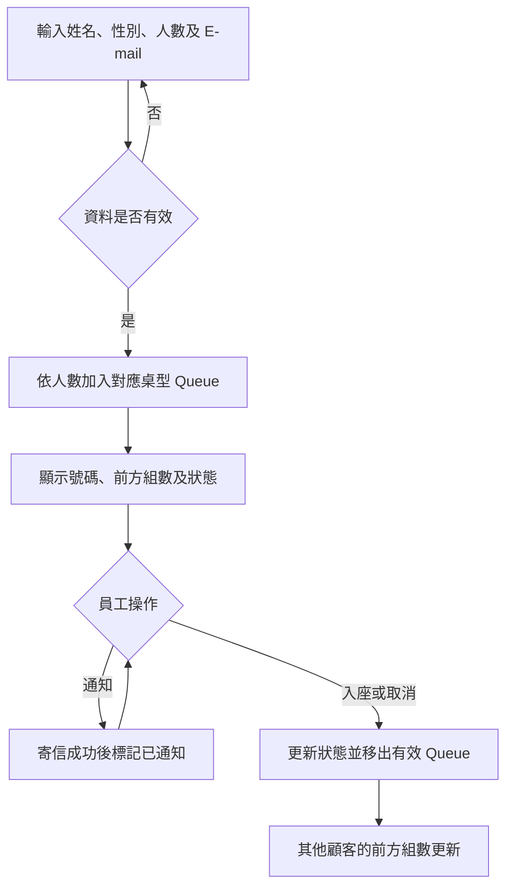

# 以 GitHub Pages 與 Google Apps Script 實作餐廳線上候位系統

- 學號：［請填寫］
- 姓名：［請填寫］
- 測試日期：2026 年 11 月 11 日；更新後程式請補填再次驗證的日期。
- 報告狀態：內容草稿；所有「待補」的設備、截圖與實際紀錄應由本人確認並補齊。

## 一、目的

餐廳使用紙本或口頭方式管理候位時，顧客往往要留在現場確認進度，員工也需要反覆查詢名單並通知客人。本系統讓顧客掃描 QR Code，以手機輸入資料取得號碼，並持續查看同桌型的等候組數。員工登入後可以查看候位、寄送電子郵件通知、安排入座或取消，減少人工查詢所需時間。前端放在 GitHub Pages，提供可公開開啟的網址；後端使用 Google Apps Script 執行驗證、候位邏輯與寄信，並利用私人 Google 試算表保存資料。此架構適合作業與小規模展示，不需另外維護常駐伺服器，也能練習 Queue、前後端資料交換及雲端部署。

## 二、實作與測試環境（3.1）

- GitHub 帳號：`Lucas950219`
- 儲存庫：<https://github.com/Lucas950219/data_structure>
- 顧客頁：<https://lucas950219.github.io/data_structure/waitlist.html>
- 員工頁：<https://lucas950219.github.io/data_structure/staff.html>
- Google 帳號：［待補，可遮蔽部分帳號］
- 手機型號與測試台數：［待補實際型號、數量］
- 瀏覽器與作業系統：［待補實際使用的版本］
- 後端：Google Apps Script V8、Google Sheets、MailApp；執行身分與存取權限請以部署畫面截圖為準。

## 三、系統規劃（3.2）

### 架構圖



### 流程圖



### API 清單

網頁透過表單 `POST` 將以下內部路徑交給 Apps Script 的 `doPost`，由 `route_` 檢查後執行；`GET` 和 `POST` 是資料中的操作方法。公開檢查網址另使用一般 `doGet`。

| 路徑或網址參數 | 方法 | 用途 |
|---|---|---|
| `?action=count` | GET | 回傳目前有效候位總組數 |
| `?action=log&key=員工密碼` | GET | 驗證密碼後輸出事件統計與紀錄；不回傳顧客姓名或 E-mail |
| `/api/queue/summary` | GET | 公開的桌型候位數 |
| `/api/queue` | POST | 檢查資料、加入候位並產生顧客 token |
| `/api/queue/status` | GET | 以顧客 token 查詢進度 |
| `/api/queue/cancel` | POST | 以顧客 token 取消候位 |
| `/api/staff/login` | POST | 檢查員工密碼並簽發短期 token |
| `/api/staff/queue`、`/api/staff/stats` | GET | 驗證員工後讀取清單與統計 |
| `/api/staff/entries/{id}/notify`、`seat`、`cancel` | POST | 驗證員工後通知、入座或取消 |

員工密碼儲存在 Apps Script 指令碼屬性，不寫在 GitHub 程式檔案中。登入後的員工 token 有效期限為 8 小時。

## 四、Queue 設計（3.3）

`WaitlistQueue` 以 JavaScript 陣列保存某一天、某桌型目前有效的候位項目。每次請求先從 Google Sheets 讀取資料，依日期、桌型和狀態過濾並按加入時間排序，再建立 Queue；試算表因此保存跨次請求的資料。加入、入座與取消的寫入以 `LockService` 鎖定，降低同時操作造成號碼重複的機會。

以下摘自 `apps_script/Code.gs`：

```javascript
class WaitlistQueue {
  constructor() { this.items = []; }
  enqueue(entry) { this.items.push(entry); }
  remove(id) {
    const index = this.positionOf(id);
    return index < 0 ? null : this.items.splice(index, 1)[0];
  }
  positionOf(id) { return this.items.findIndex(item => item.id === String(id)); }
  size() { return this.items.length; }
  toArray() { return this.items.slice(); }
}
```

- `enqueue` 用 `push` 將資料加入尾端；`activeQueue_` 從試算表重建當日同桌型 Queue 時呼叫它。
- `positionOf` 用 `findIndex` 取得位置，位置 0 代表前方沒有其他組；相同加入時間時依原有紀錄順序排列。
- `remove` 找到指定 ID 後用 `splice` 移除，入座與取消前會確認該組仍在 Queue；狀態更新再寫回試算表。
- 1–2 位為 2 人桌，3–4 位為 4 人桌，前方組數分別計算。試算表沒有程式硬編碼的 50 組上限，但仍受 Google 服務配額和讀取整張表的效能限制。

## 五、部署過程（3.4）

1. 在 Apps Script 貼入 `Code.gs`，執行 `setupWaitlist` 和 `authorizeGmail` 並授權。
2. 設定 `STAFF_PASSWORD`、`PUBLIC_SITE_URL` 和 `WAIT_MIN_PER_GROUP` 等指令碼屬性。
3. 將網頁應用程式設定為以部署者身分執行、所有人可存取；修改程式後在「管理部署作業」建立新版本。
4. GitHub Actions 發布 Pages；`config.js` 指向目前使用的 Apps Script `/exec` 網址。
5. 開啟部署網址加 `?action=count`，沒有等候者時回傳 `{"waiting":0}`。

［待補：部署設定中執行身分及存取權限截圖、`?action=count` 結果、GitHub Pages 上線截圖。截圖不可露出員工密碼。］

## 六、前後端溝通（3.5）

- `waitlist.html` 與 `app.js` 負責顧客表單、候位卡及自動更新；`staff.html` 與 `staff.js` 負責登入、清單和操作；`styles.css` 負責樣式。
- `config.js` 設定服務網址；`api.js` 提供兩個頁面共用的通訊方法。它建立隱藏表單，將請求以瀏覽器表單 POST 到 Apps Script，結果由回應頁使用 `postMessage` 傳回。前端檢查回應來源與隨機請求 ID。
- 本專案使用**表單 POST**，不是用 `fetch` 呼叫 Apps Script。瀏覽器會自動使用表單的 `application/x-www-form-urlencoded` 格式，因此程式沒有自行設定 `Content-Type`。若改用跨網域 `fetch` 並設定 `application/json`，瀏覽器通常會先進行 CORS preflight；並不是所有 POST 都不能設定 `Content-Type`。
- 本版不依賴前端保存員工密碼；每次員工資料讀取與操作由後端驗證 token。

## 七、顧客端實測（3.6）

使用者已回報可取得號碼並掃描 QR Code。另以後端測試資料驗證 2 人桌和 4 人桌各加入一組，測試結束後均取消；測試資料會計入今日取消統計。

［待補：至少 3 組不同顧客的手機掃 QR、填表、號碼及前方組數截圖，使用自己或同組同學的 E-mail；避免暴露個人資料。不可把虛構測試者當作實際手機測試。］

## 八、員工端實測（3.7）

使用者已回報登入、錯誤密碼拒絕及清單顯示正常。先前發生員工頁顯示 0 組時，檢查發現網站使用舊版部署；更新網站設定並處理瀏覽器快取後，使用者回報清單顯示成功。

［待補：至少同時有 3 組候位的員工清單、登入和錯誤密碼畫面截圖。］

## 九、通知功能實測（3.8）

使用者已回報按「通知」後收到郵件，顧客狀態變成「已通知」。系統以部署者 Google 帳號的 `MailApp.sendEmail` 寄信；只有成功後才標記已通知。

［待補：員工通知提示、實際收到的 E-mail、顧客「已通知」狀態三張截圖；遮蔽不需公開的信箱。］

## 十、入座與取消（3.9）

使用者已回報第一組入座後，清單減少且後一組的前方組數減少；也回報顧客自行取消及員工清單更新正常。

［待補：同桌型兩組顧客在入座或取消前後的清單與前方組數對照截圖。］

## 十一、事件紀錄（3.10）

更新並部署新版 `Code.gs` 後，在 Apps Script 網址後加 `?action=log&key=員工密碼`。系統用既有列的加入、通知、入座及取消時間重建事件，回傳各類 `counts` 與不含姓名和 E-mail 的 `events`。它反映已保存的時間戳記，不是紀錄每一次嘗試的獨立稽核日誌。

［待補：本人開啟完整輸出並另存文字檔；確認至少 3 組加入、1 次通知、1 組入座。不要在報告、截圖或 GitHub 上留下含真實密碼的網址。填入本次實際數量：加入＿＿、通知＿＿、入座＿＿、取消＿＿。］

## 十二、錯誤與排除（3.11）

實際遇到員工頁沒有顯示候位。檢查後，新部署的候位數量與網站使用的舊部署不同；因此更新 Pages 的 Apps Script 網址，並為設定檔加上版本參數，避免瀏覽器繼續使用舊設定。重新發布並重新開啟員工頁後，使用者回報已能看到資料。程式也補上試算表日期格式的讀取處理，避免日期被轉換時無法和今天的日期比對；當時沒有取得試算表資料，因此無法證實日期格式就是該次問題的唯一原因。

［待補：錯誤發生時與排除後的實際畫面截圖。］

## 十三、結論與心得（3.12）

依照目前的實測回報，顧客可以取得號碼、員工可以查看名單並發送通知，入座和取消也能反映在等候組數。這次實作練習了以陣列建立 Queue、利用試算表保存資料、將網頁部署到 GitHub Pages，以及透過 Apps Script 結合寄信。

若要在真實餐廳使用，仍需加強重複登記防護、資料保存期限、錯誤復原、並發效能和個資管理；也要注意 Google 服務的使用配額。［請依個人實際學習經驗補充心得。］

## 繳交前檢查

- [ ] 補上學號、姓名、設備、瀏覽器與所有實際截圖。
- [ ] 更新並重新部署新版 `Code.gs`，重新驗證 Queue 和事件紀錄。
- [ ] 準備至少 3 組不同顧客的實測及符合數量要求的事件紀錄文字檔。
- [ ] 繳交用前端副本中的 API 網址改為假值；員工密碼不可出現在程式、報告或紀錄檔中。
- [ ] 將前端檔案、`Code.gs`、顧客 QR Code、報告和事件紀錄文字檔打包為 `學號_姓名_候位系統.zip`。
- [ ] 作業結束後依老師要求封存部署並清除測試個資；本版本目前沒有 `?action=reset`，清除前需確認方式。
